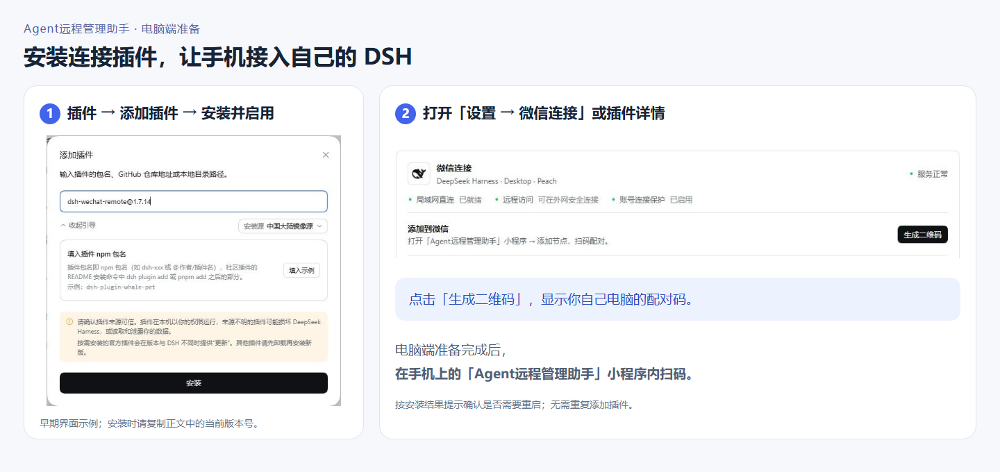
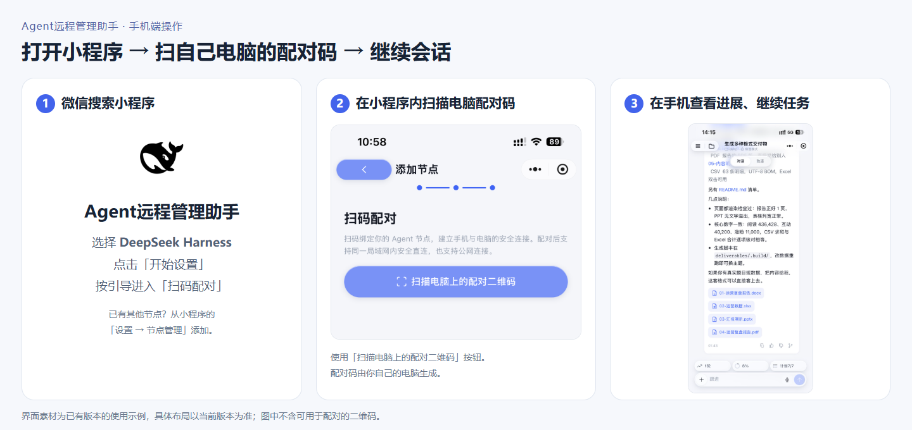

# Agent远程管理助手

**在微信里，接着用自己电脑上的 DeepSeek Harness。**

「**Agent远程管理助手**」是手机上的微信小程序，用来查看会话进展、发送任务、处理问答与审批、收取任务文件。本仓库提供配套的 **DSH 微信连接插件**：装在电脑上，让小程序连接你的 DSH。任务由电脑上的 DSH 执行，手机负责远程操作与查看。

**手机端入口：微信搜索小程序「Agent远程管理助手」。** 电脑需保持开机、联网，并运行 DSH。支持局域网直连与端到端加密公网连接。

插件当前正式版：**1.7.16** · [下载与更新说明](https://github.com/martinbear1/dsh-wechat-remote/releases/tag/v1.7.16)

## 一、安装：在电脑 DSH 中添加插件

打开电脑上的 **DSH → 插件 → 添加插件**，复制下面的包名，安装并启用。Web 与 Desktop 使用同一个包名：

```text
dsh-wechat-remote@1.7.16
```

按安装结果确认是否已生效；如提示需要重启，请结束任务后正常重启对应 DSH。然后打开 **设置 → 微信连接**，或进入 **微信连接插件详情**。



*图为已有版本的界面示例；安装请复制上方当前版本的包名。*

也可从 [Release](https://github.com/martinbear1/dsh-wechat-remote/releases/tag/v1.7.16) 下载完整安装包 `dsh-wechat-remote-1.7.16.tgz`。`@latest` 可用于选择最新版，但新发布时部分安装环境可能仍选中旧版或要求等待，请按安装提示处理。没有图形插件管理器的旧 Web 环境，见 [安装器使用说明](installer/README.md)。

## 二、配对：在「Agent远程管理助手」小程序里扫码

1. **电脑上**：打开「微信连接」，点击 **生成二维码**，显示当前电脑节点的配对码。
2. **手机上**：在微信搜索并打开 **Agent远程管理助手**，选择 **DeepSeek Harness**，点击「开始设置」，按引导进入「扫码配对」。已有节点时，可从小程序「设置 → 节点管理」添加节点。
3. **在小程序内**点击 **扫描电脑上的配对二维码**，扫描刚才电脑上生成的码，按提示完成绑定。



配对成功后，在小程序里打开会话列表，选择已有会话继续跟进，或新建会话开始任务。问答、审批和任务文件也在手机上处理。Web 与 Desktop 是独立节点，使用哪一端就配对哪一端；多台电脑可以分别添加。

完整自动化任务管理需配套新版小程序；若手机暂未提供相应操作，可先在电脑端管理。

## 三、升级：从已有插件检查更新

在电脑 DSH 的 **设置 → 微信连接** 或 **微信连接插件详情**中，点击 **检查更新**，按提示完成安装。**无需先卸载，也不需要重新配对。**

- **已生效**：直接继续使用。
- **提示待重启**：等待任务结束。Desktop 完全退出并重新打开；Web 按原启动方式重启实际服务，仅刷新网页不等于重启。
- **有多个节点**：Web、Desktop 及不同电脑分别检查更新。

<details>
<summary>旧版升级与安装问题</summary>

- Web 插件 `1.7.13` 若提示“请回到 DSH 原生插件管理页更新”，请正常停止 Web，在原系统用户及环境下运行 `npx -y dsh-wechat-remote@1.7.16`。安装器替换原插件并保留配对与会话，不修改 Desktop。详见 [Web 旧版升级说明](docs/NATIVE-INSTALL.md#web-旧版提示请回到-dsh-原生插件管理页更新)。Desktop `1.7.13` 继续使用插件内更新入口。
- 从旧 `1.7.14` 首次升级后，如连接暂时不可用或反复重连，请结束任务后完整退出并重开对应 DSH，无需反复安装或重新配对。
- 重复添加相同包名可能提示“已安装”，不代表完成更新。历史命令行安装不要再叠加另一份插件。
- 下载或安装失败时，按入口提示检查网络并重试；结果不明时先保留日志与数据，不要删除配对或降低 DSH 版本。

支持 Windows、macOS 与 Linux 的对应安装流程；具体宿主版本与组合以实际验证为准。公共 Wi-Fi 的设备隔离、代理或网络封锁可能影响连接。

</details>

[详细安装与更新说明](docs/NATIVE-INSTALL.md) · [版本更新说明](RELEASE-NOTES.md) · [安全问题报告](SECURITY.md)
